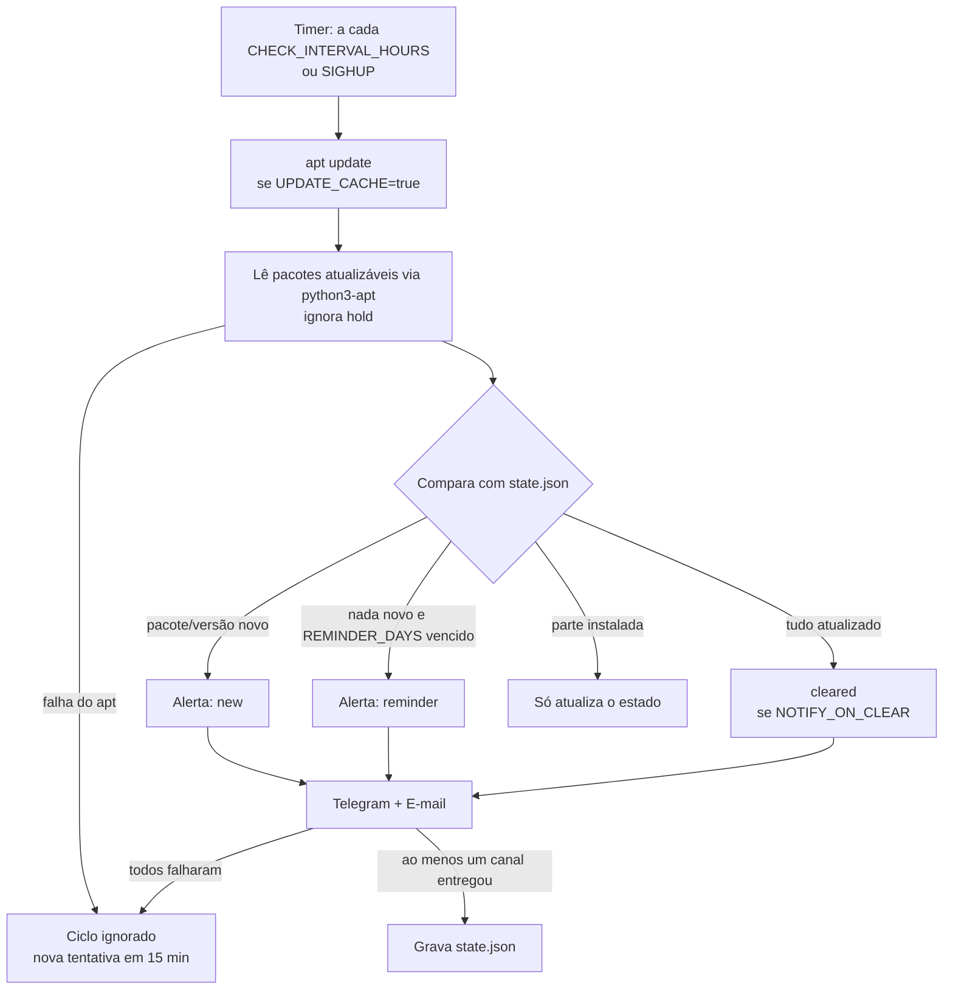

# Como funciona

## Visão geral

## Decisão de alertas

O estado guarda o conjunto `nome=versão` já notificado, o instante do último alerta e se o aviso de reboot já saiu.

| Situação | Resultado |
|---|---|
| Surgiu pacote ou versão que não estava no estado | **Alerta** (`new`) com a lista completa pendente |
| Mesma lista, `REMINDER_DAYS` vencido | **Lembrete** (`reminder`) |
| Lista encolheu (você instalou parte) | Silencioso; só atualiza o estado |
| Lista vazia, antes havia pendência | `Servidor em dia` se `NOTIFY_ON_CLEAR=true` |
| `/var/run/reboot-required` apareceu | Alerta de **reinicialização** (uma vez por ocorrência) |
| `apt` falhou (rede, lock, cache) | Ciclo ignorado — **não** conta como "tudo atualizado" |
| Nenhum canal conseguiu entregar | Estado **não** é gravado; nova tentativa em até 15 min |

Por isso `restart`, reboot, upgrade do pacote e rotação de log não geram alertas repetidos.

## Classificação

* **Kernel (crítico 🚨):** `linux-image-*`, `linux-signed-image-*`, metapacotes (`linux-generic`, `linux-virtual`,
  `linux-aws`, `linux-azure`, `linux-gcp`…), `raspberrypi-kernel`. *Não* inclui headers, módulos, ferramentas nem
  `linux-firmware`.
* **Segurança 🔐:** a versão candidata vem de um repositório cujo `Archive` termina em `-security`
  (Debian/Ubuntu, inclusive ESM) ou cujo `Label` é `Debian-Security`.
* **Hold:** pacotes marcados com `apt-mark hold` são ignorados.

## Arquivos

| Caminho | Função |
|---|---|
| `/usr/lib/apt-monitor/apt_monitor.py` | o daemon (também disponível como `/usr/sbin/apt-monitor`) |
| `/etc/apt-monitor/apt-monitor.conf` | configuração (`0600`, contém credenciais) |
| `/var/lib/apt-monitor/state.json` | estado (o que já foi notificado) |
| `/var/log/apt-monitor.log` | log próprio, rotação semanal sem reiniciar o serviço |
| `/usr/lib/systemd/system/apt-monitor.service` | unit do systemd |
| `/etc/logrotate.d/apt-monitor` | rotação do log |

## Sinais e códigos de saída

| | |
|---|---|
| `SIGHUP` (`systemctl reload`) | recarrega a configuração e executa um ciclo imediatamente; configuração inválida é recusada e a anterior é mantida |
| `SIGTERM`/`SIGINT` | encerra limpo (código 0) |
| Código `78` | configuração inválida; o systemd **não** reinicia (`RestartPreventExitStatus=78`) |
| Código `1` (`--once`/`--test-notify`) | nenhum canal entregou |

## Segurança

* O serviço roda como root (o `apt update` exige), mas com `NoNewPrivileges`, `ProtectSystem=strict` (escrita só em
  `/var/lib/apt`, `/var/cache/apt`, `/var/lib/dpkg`, `/var/log` e `/var/lib/apt-monitor`), `ProtectHome`, `PrivateTmp`,
  `PrivateDevices`, `RestrictAddressFamilies`, `RestrictNamespaces` e outros.
* Token do Telegram e senha SMTP são removidos de qualquer mensagem de log, inclusive de erros de rede.
* Credenciais SMTP só trafegam sob TLS (a menos que você force `SMTP_SECURITY=none`).
* Todo texto dinâmico (hostname, nomes de pacote) é escapado em HTML.
* Verifique a exposição do unit com `systemd-analyze security apt-monitor`.

## Estrutura do código

`src/apt_monitor.py` (biblioteca padrão + `python3-apt`, compatível com Python ≥ 3.6):

* `load_config` / `Config` — leitura e validação do `.conf`;
* `collect_updates`, `reboot_required`, `get_machine_ips` — informações do sistema;
* `Alert` — conteúdo das mensagens (Telegram HTML, e-mail HTML e texto);
* `TelegramNotifier`, `EmailNotifier` — canais; qualquer classe com `name` e `send(alert) -> bool` vira um canal;
* `State`, `decide`, `Monitor` — lógica de estado e decisão (testável sem rede nem apt);
* `Daemon`, `main` — loop, sinais e CLI.
