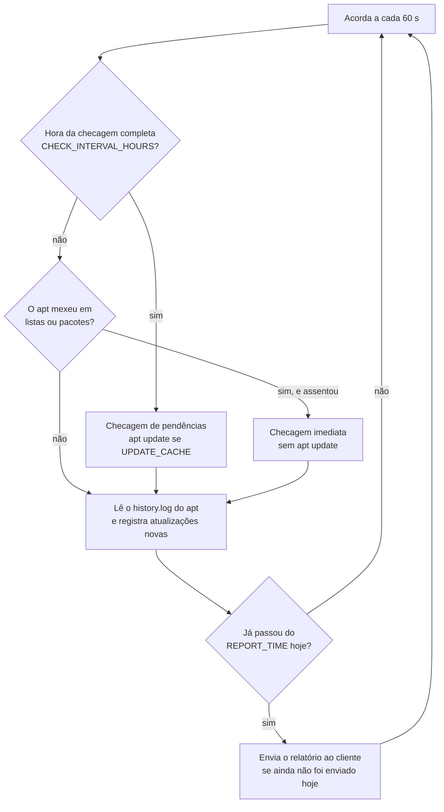
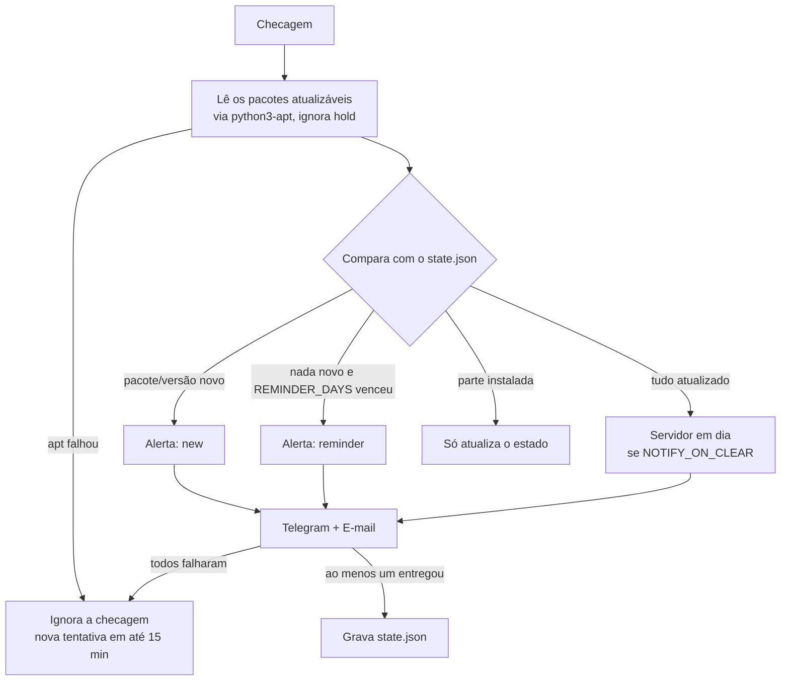
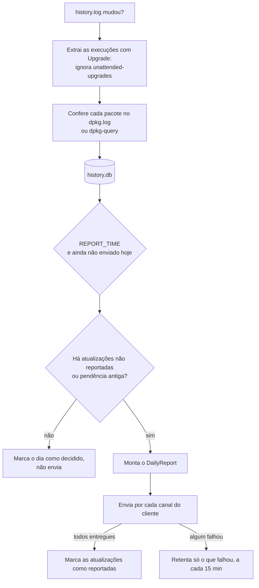

# Como funciona (arquitetura)

Visão técnica do APT Monitor Plus: fluxos, estado, banco de dados, tempos e segurança.

## Índice

- [Visão geral](#visão-geral)
- [Dois fluxos independentes](#dois-fluxos-independentes)
- [Alertas aos administradores](#alertas-aos-administradores)
- [Histórico e relatório ao cliente](#histórico-e-relatório-ao-cliente)
- [Banco de dados](#banco-de-dados)
- [Tempos e constantes](#tempos-e-constantes)
- [Arquivos](#arquivos)
- [Sinais e códigos de saída](#sinais-e-códigos-de-saída)
- [Segurança](#segurança)
- [Estrutura do código](#estrutura-do-código)

## Visão geral

Um único processo Python (daemon do systemd, biblioteca padrão + `python3-apt`, compatível com Python ≥ 3.6) com um
laço que **acorda a cada 60 segundos** e faz três coisas, todas baratas:

## Dois fluxos independentes

| | Alertas (administradores) | Relatório (cliente) |
|---|---|---|
| Insumo | Pacotes **pendentes** (`python3-apt`) | O que foi **feito** (`history.log` + `dpkg.log`) |
| Memória | `state.json` (o que já foi avisado) | `history.db` (SQLite) |
| Quando | Na hora: intervalo **e** mudança do apt | Uma vez por dia, em `REPORT_TIME` |
| Canais | `[Telegram]`, `[Email]` | `[ClientTelegram]`, `[ClientEmail]` |

Os dois fluxos **não se misturam**: um bot do cliente nunca recebe um alerta, e os administradores nunca recebem o
relatório.

## Alertas aos administradores

- **Classificação.** *Kernel* (crítico): `linux-image-*`, `linux-signed-image-*` e metapacotes (`linux-generic`,
  `linux-virtual`, `linux-aws`…, `raspberrypi-kernel`); **não** headers, módulos, ferramentas nem `linux-firmware`.
  *Segurança*: a versão candidata vem de um repositório cujo `Archive` termina em `-security` (Debian/Ubuntu, inclusive
  ESM) ou cujo `Label` é `Debian-Security`.
- **Detecção imediata.** O laço guarda a data de modificação de `/var/lib/apt/lists` e `/var/lib/dpkg/status`. Quando
  mudam e ficam **20 s parados** (o `apt update` terminou), ele refaz a checagem **sem** rodar outro `apt update`. A
  atualização que o próprio Plus faz **não** conta como novidade (senão haveria um laço).
- **Entrega.** Telegram: 3 tentativas por chat, com espera crescente e respeito ao `retry_after` do 429. SMTP: uma
  conexão, uma mensagem por destinatário; um destinatário ruim não derruba os demais. Se **nenhum** canal entregar, o
  estado não é gravado e o alerta é retentado em até 15 min.

## Histórico e relatório ao cliente

- **Leitura do apt.** `/var/log/apt/history.log` (e `history.log.1.gz`/`.1`): cada bloco com `Upgrade:` vira uma
  execução; `unattended-upgrade` na linha de comando a marca como automática e ela é descartada. Blocos sem `End-Date`
  recentes (< 5 min) são adiados.
- **Sucesso por pacote.** `/var/log/dpkg.log` (e `.1`): linha `status installed <pacote> <versão>` na versão nova, com
  data a partir do início da execução (−5 s). Sem registro no log, o `dpkg-query` decide (`installed` e versão `≥` a
  esperada).
- **Pendências.** A cada checagem, o Plus espelha a lista de pendentes na tabela `pending`, guardando `first_seen`
  (quando foi visto pela primeira vez). Ao gerar o relatório, se algum pendente tem `agora − first_seen > PENDING_ALERT_DAYS`,
  **todos** entram no relatório.
- **Fuso sem `zoneinfo`.** O horário e a data do relatório usam o fuso configurado trocando temporariamente `TZ` do
  processo (funciona em Python 3.6+). O nome do fuso é validado contra `/usr/share/zoneinfo`.

## Banco de dados

`/var/lib/apt-monitor-plus/history.db` (SQLite, modo `0600`). Criado na primeira execução; só registra o que acontece
**depois** dessa criação.

| Tabela | Conteúdo |
|---|---|
| `meta` | `since_ts`: instante da criação do banco (nada anterior é importado) |
| `runs` | Uma linha por atualização: início, fim, comando, `ok`, `failed`, `reported_day`. Única por `(início, comando)` |
| `run_packages` | Os pacotes de cada atualização: nome, versão antiga, versão nova, `ok` |
| `pending` | Pacotes pendentes agora: nome, versões, segurança e `first_seen` |
| `daily_reports` | `(dia, canal)` já resolvidos (enviado ou, `skipped`, sem nada a enviar) |

## Tempos e constantes

| Constante | Valor | Para quê |
|---|---|---|
| `POLL_INTERVAL` | 60 s | Intervalo do laço (histórico do apt, horário do relatório, mudanças do apt) |
| `APT_SETTLE` | 20 s | Quanto o apt precisa ficar quieto antes da checagem imediata |
| `RETRY_INTERVAL` | 15 min | Nova tentativa após falha de entrega ou do apt |
| `INPROGRESS_GRACE` | 5 min | Tolerância para uma execução do apt ainda em andamento |
| `CHECK_INTERVAL_HOURS` | 4 h (configurável) | Checagem completa de segurança |

## Arquivos

| Caminho | Função |
|---|---|
| `/usr/lib/apt-monitor-plus/apt_monitor.py` | O daemon (também `/usr/sbin/apt-monitor-plus` e o atalho `/usr/sbin/apt-monitor`) |
| `/etc/apt-monitor-plus/apt-monitor.conf` | Configuração (`0600`, contém credenciais) |
| `/var/lib/apt-monitor-plus/state.json` | O que já foi avisado aos administradores |
| `/var/lib/apt-monitor-plus/history.db` | Histórico, pendências e relatórios enviados |
| `/var/log/apt-monitor-plus.log` | Log próprio (rotação semanal, sem reiniciar o serviço) |
| `/usr/lib/systemd/system/apt-monitor-plus.service` | Unit do systemd |
| `/etc/logrotate.d/apt-monitor-plus` | Rotação do log |
| `/usr/share/doc/apt-monitor-plus/` | README, esta documentação e `examples/apt-monitor.conf` |

## Sinais e códigos de saída

| | |
|---|---|
| `SIGHUP` (`systemctl reload`) | Recarrega a configuração e checa na hora; configuração inválida é recusada e a anterior é mantida |
| `SIGTERM`/`SIGINT` | Encerra limpo (código 0) |
| Código `78` | Configuração inválida; o systemd **não** reinicia (`RestartPreventExitStatus=78`) |
| Código `1` (`--once`/`--test-notify`/`--report`) | Nenhum canal entregou |

## Segurança

- O serviço roda como root (o `apt update` exige), mas com `NoNewPrivileges`, `ProtectSystem=strict` (escrita só em
  `/var/lib/apt`, `/var/cache/apt`, `/var/lib/dpkg`, `/var/log` e `/var/lib/apt-monitor-plus`), `ProtectHome`,
  `PrivateTmp`, `PrivateDevices`, `RestrictAddressFamilies`, `RestrictNamespaces` e outros. Verifique a exposição com
  `systemd-analyze security apt-monitor-plus`.
- **Token do Telegram e senha SMTP** (dos dois públicos) são removidos de qualquer mensagem de log, inclusive de erros
  de rede.
- O `.conf` e o `history.db` ficam com modo **0600**.
- Credenciais SMTP só trafegam **sob TLS** (a menos que você force `SMTP_SECURITY=none`).
- **Todo texto dinâmico** (hostname, nomes de pacote, `ADMIN_NAME`) é escapado em HTML, evitando injeção.
- Os e-mails **não carregam imagens nem recursos externos**: nada é baixado quando o cliente abre a mensagem (sem
  rastreamento).
- O cliente nunca recebe IPs nem alertas dos administradores (veja [Dados e privacidade](relatorio.md#dados-e-privacidade)).

## Estrutura do código

`plus/src/apt_monitor.py`:

- `load_config` / `Config` / `_parse_email` — leitura e validação do `.conf`.
- `collect_updates`, `reboot_required`, `get_machine_ips` — informações do sistema.
- `parse_history`, `Verifier`, `HistoryDB` — leitura do `history.log`, confirmação por pacote e o banco SQLite.
- `timezone`, `report_due`, `next_report_ts`, `apt_signature`, `apt_changed` — fuso do relatório e detecção de mudança.
- `Alert` (alertas dos administradores) e `DailyReport` (relatório do cliente) — conteúdo das mensagens (Telegram HTML,
  e-mail HTML e texto). Compartilham a mesma interface (`subject`, `telegram_text`, `email_text`, `email_html`).
- `TelegramNotifier`, `EmailNotifier` — canais; qualquer classe com `name` e `send(mensagem) -> bool` vira um canal.
- `State`, `decide`, `Monitor` — lógica de estado, decisão, ingestão do histórico e relatório (testável sem rede nem apt).
- `Daemon`, `main` — laço, sinais e CLI.
