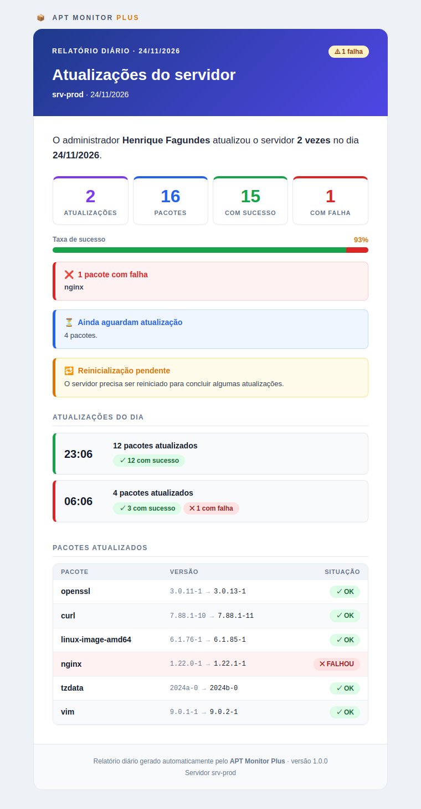
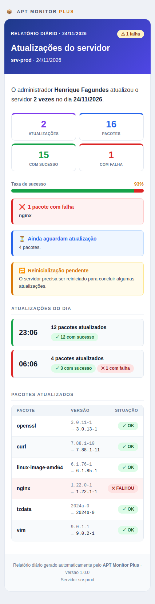
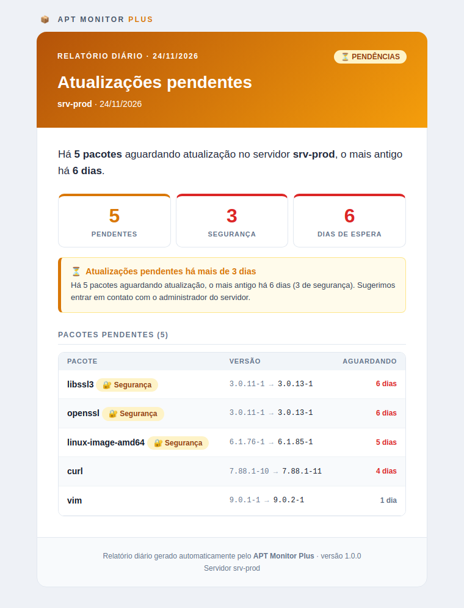
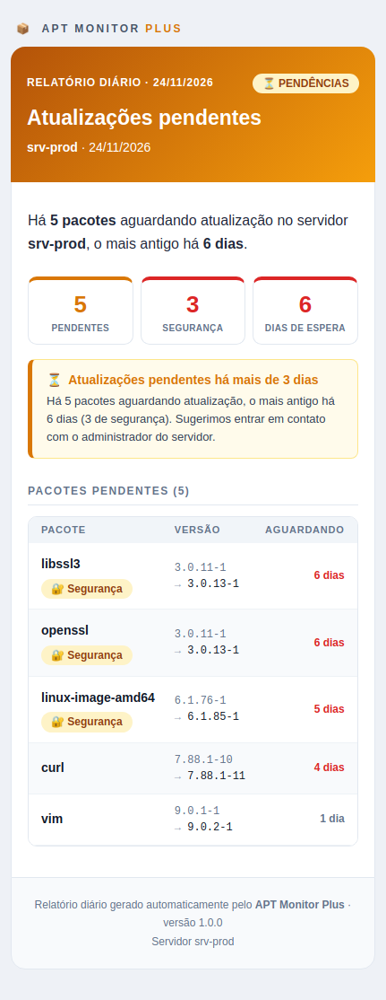

# Relatório diário para o cliente

Depois que o administrador atualiza o servidor, o **cliente recebe um relatório por dia**, por um bot do Telegram
próprio e/ou por e-mail, dizendo quantas vezes houve atualização e quantos pacotes foram atualizados (com sucesso e
com falha). Se algum pacote fica pendente por tempo demais, o relatório avisa e sugere falar com o administrador.

Os **administradores não recebem esse relatório**: eles recebem os [alertas de atualização disponível](uso.md#catálogo-de-mensagens),
na hora.

Para configurar, comece pelo [guia do cliente](cliente.md). Todas as chaves estão na
[Referência de configuração](configuracao.md#report--o-relatório-diário-do-cliente).

## Índice

- [Exemplos](#exemplos)
- [Como o Plus sabe o que foi atualizado](#como-o-plus-sabe-o-que-foi-atualizado)
- [Quando o relatório é enviado](#quando-o-relatório-é-enviado)
- [Pendências antigas](#pendências-antigas)
- [Casos de borda](#casos-de-borda)
- [Dados e privacidade](#dados-e-privacidade)

---

## Exemplos

### Dia com atualizações

Telegram:

```text
📋 Relatório diário de atualizações — 24/11/2026
🖥️ Servidor: srv-prod

👤 O administrador Henrique Fagundes atualizou o servidor 2 vezes em 24/11/2026.

📦 Pacotes atualizados: 16
✅ Com sucesso: 15
❌ Com falha: 1

⏳ Ainda aguardam atualização: 4

🔁 Reinicialização pendente
```

E-mail (HTML, com a mesma informação mais a linha do tempo e a tabela de pacotes):

| Desktop | Celular |
|---|---|
|  |  |

### Dia sem atualização, mas com pendência antiga

Assunto do e-mail: `[srv-prod] Atenção: atualizações pendentes - 24/11/2026`. Telegram:

```text
⏳ Atualizações pendentes — 24/11/2026
🖥️ Servidor: srv-prod

⚠️ Há 2 pacotes aguardando atualização, o mais antigo há 6 dias (1 de segurança).
📞 Sugerimos entrar em contato com o administrador do servidor.

📋 Pacotes pendentes:
• openssl — 6 dias 🔐
• curl — 4 dias
```

E-mail:

| Desktop | Celular |
|---|---|
|  |  |

---

## Como o Plus sabe o que foi atualizado

O Plus **observa o apt**, sem depender de nenhum gancho (*hook*) e sem você fazer nada de diferente:

1. A cada cerca de 1 minuto ele vê se o `/var/log/apt/history.log` mudou. (Também lê o log girado,
   `history.log.1.gz`, caso a virada de mês aconteça no meio.)
2. Cada execução do apt em que houve **`Upgrade:`** (pacotes atualizados) vira **uma "atualização"** no histórico.
   Só instalar (`apt install`) ou remover pacotes **não conta**.
3. **Sucesso ou falha, pacote a pacote:** um pacote só conta como "com sucesso" se o `/var/log/dpkg.log` mostra que ele
   chegou ao estado `installed` na **versão nova**. Se o log já girou, o Plus consulta o `dpkg-query` e confere se a
   versão instalada é igual ou maior que a esperada. Qualquer outra situação conta como "com falha".
4. Execuções do **`unattended-upgrades`** (atualização automática) **não entram**: não são trabalho do administrador.
5. Uma execução do apt que ainda está em andamento (sem `End-Date` e com o arquivo mexido há menos de 5 minutos) é
   adiada até terminar.

Tudo isso fica no banco SQLite `/var/lib/apt-monitor-plus/history.db`. O banco só registra o que acontece **depois da
sua criação**: atualizações antigas nunca são reenviadas.

## Quando o relatório é enviado

- **Uma vez por dia**, a partir de `REPORT_TIME`, no fuso `REPORT_TIMEZONE` (padrão: 22:30, São Paulo).
- Ele inclui **tudo o que ainda não foi reportado**. Uma atualização feita **depois** do horário do relatório (por
  exemplo, às 23:00) entra no relatório do **dia seguinte**.
- **Dia sem novidade = nada enviado.** O Plus "decide" uma vez por dia; se não havia o que reportar, esse dia está
  resolvido e uma atualização feita mais tarde espera o dia seguinte (em vez de disparar um relatório fora de hora).
  Com `SEND_EMPTY=true` o relatório sai mesmo assim ("Nenhuma atualização foi realizada em …").
- **Cada canal é controlado separadamente.** Se o Telegram entregou e o e-mail falhou, apenas o e-mail é retentado, a
  cada 15 minutos, **sem reenviar** ao Telegram.
- **Servidor desligado ou sem rede no horário:** o relatório sai assim que o serviço voltar a funcionar, no mesmo dia.
  Se ficou o dia todo parado, o que ficou por reportar entra no relatório do dia seguinte.
- **Antecipar:** `sudo apt-monitor-plus --report` envia agora; o relatório programado daquele dia **não** é repetido.

## Pendências antigas

O relatório também vigia o que **não** foi feito. Se, no horário do relatório, **algum pacote espera instalação há mais
de `PENDING_ALERT_DAYS` dias** (padrão: **3**) e o administrador não atualizou:

- O cliente recebe o relatório com **todos os pacotes pendentes** (não só os antigos), a **idade de cada um**
  (em vermelho os que passaram do prazo) e um selo 🔐 nos de segurança.
- O texto sugere: **"Sugerimos entrar em contato com o administrador do servidor."** Nesse trecho **nunca há
  nomes**, nem o do administrador.
- Vale **também para dias sem nenhuma atualização**: nesse caso o relatório troca de foco ("Atualizações
  pendentes") em vez de mostrar zeros.
- Se no **mesmo dia** houve atualização, os dois blocos vão no **mesmo relatório** (continua sendo um por dia).
- **Repete todos os dias** até o administrador instalar os pacotes.
- `PENDING_ALERT_DAYS=0` **desativa** esse aviso.

**Como a idade é contada:** desde a **primeira vez em que o Plus viu** aquele pacote pendente. Se sair uma versão
mais nova do mesmo pacote, a idade **continua** (o administrador segue sem atualizar). Quando o pacote é instalado,
sai da lista; se voltar a ficar pendente, a contagem começa de novo. Por isso o primeiro aviso só aparece depois de
`PENDING_ALERT_DAYS` dias de funcionamento do Plus. A comparação é **"mais de" N dias**: com `3`, um pacote com
exatamente 3 dias ainda não conta.

## Casos de borda

| Situação | O que acontece |
|---|---|
| O administrador atualiza 3 vezes no dia | Um relatório, "atualizou o servidor **3 vezes**". |
| Atualização interrompida no meio | Os pacotes que não chegaram a `installed` contam como falha. |
| O mesmo pacote é atualizado em duas execuções | Conta em cada execução (os totais são de **atualizações de pacote**, não de pacotes únicos). |
| `ADMIN_NAME` em branco | "**A equipe técnica** atualizou o servidor…". |
| O `apt` falha ao listar pendências (rede, lock) | A lista de pendentes **não é apagada** nem a contagem de dias é zerada. |
| Mudança de fuso/horário na configuração | Vale a partir do próximo `reload`. |
| Apagou o `history.db` | O histórico e a contagem de dias recomeçam do zero; o passado não é reenviado. |
| Mais de 100 pacotes na tabela do e-mail | Mostra 100 e "… e mais N pacote(s)". No Telegram, a lista de pendentes mostra 25 e "… e mais N". |

## Dados e privacidade

O que o cliente vê e o que não vê está na tabela do [guia do cliente](cliente.md#7-o-que-o-cliente-vê-e-o-que-não-vê).
Em resumo: **nunca** vê os IPs do servidor nem os alertas dos administradores; vê o nome do servidor, o `ADMIN_NAME`,
os totais e, por e-mail, a tabela de pacotes (desligável com `PACKAGE_LIST=false`).
